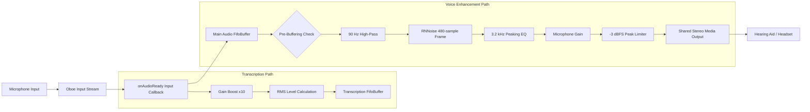
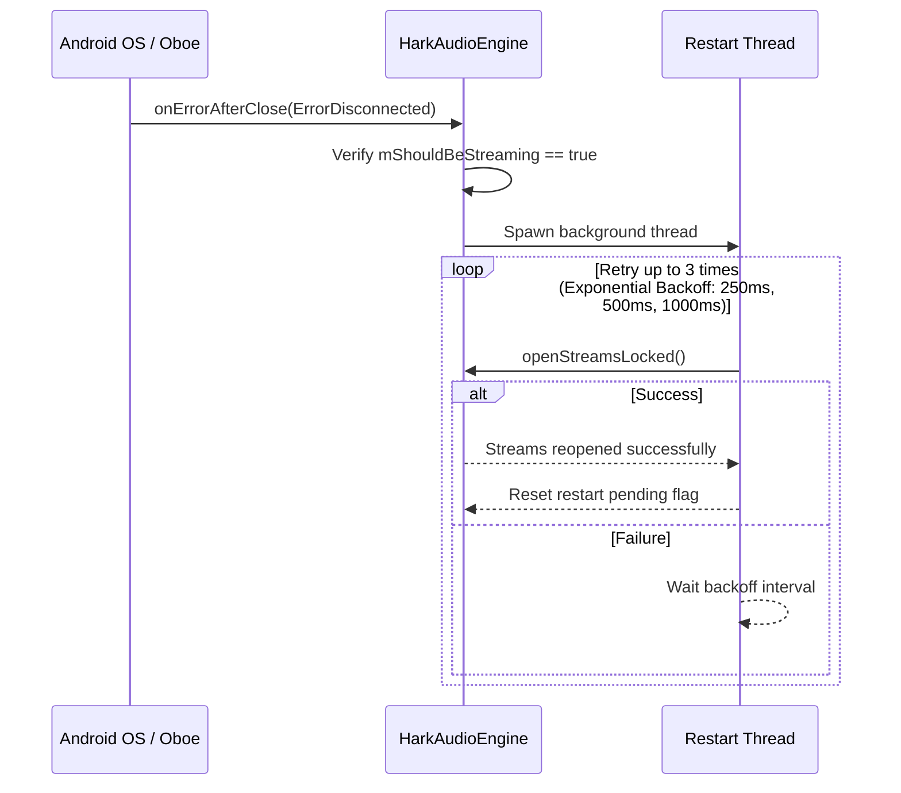

# HARK Audio Processing Engine

This document details the low-latency C++ native audio engine (**HarkAudioEngine**), Digital Signal Processing (DSP) algorithms, and stream fault-tolerance built into HARK.

---

## Engine Overview

The core audio engine (`app/src/main/cpp/hark_audio_engine.cpp` / `hark_audio_engine.h`) is written in C++17 using **Google Oboe**. It captures from a selectable input device, converts the negotiated input rate to RNNoise's 48 kHz processing rate, applies speech-focused DSP, and converts to the output route's negotiated rate and channel count. The app does not request audio focus, so Android can mix the output with other media playback.

### Key Performance Goals
- **Ultra-low latency**: Hardware-direct AAudio/OpenSL ES performance mode (`oboe::PerformanceMode::LowLatency`).
- **Zero dynamic memory allocation in callback**: Pre-allocated buffers prevent Garbage Collection (GC) pauses and audio glitches.
- **Thread safety**: Lock-free parameter updates using C++ atomics (`std::atomic`).

---

## Signal Processing Flow

---

## DSP Signal Processing

### 1. 90 Hz High-Pass Filter

The high-pass filter removes low-frequency handling and environmental rumble before denoising.

- **Filter Type**: 2nd Order Biquad high-pass
- **Cutoff Frequency ($f_0$)**: $90\text{ Hz}$
- **Q**: $0.707$

### 2. RNNoise

The engine compiles the upstream RNNoise v0.1.1 C implementation at a pinned commit. It processes 480-sample (10 ms) mono frames at 48 kHz. Input and output callbacks communicate through Oboe's single-producer/single-consumer FIFO; the denoiser state and frame buffers are initialized before streaming, not allocated in the callback. Noise suppression is enabled by default and can be disabled in Audio Engine settings.

Built-in, wired, and USB microphones use Android's `VoiceRecognition` input preset so platform voice-communication suppression does not pre-process the signal before RNNoise. Bluetooth headset microphones use `VoiceCommunication` to retain compatibility with communication-profile routing.

### 3. Speech-Presence Peaking EQ

- **Filter Type**: 2nd Order Biquad peaking EQ
- **Center Frequency**: $3200\text{ Hz}$
- **Gain**: User-adjustable from $+3$ to $+8\text{ dB}$ (default $+6\text{ dB}$)
- **Q**: $1.0$

The coefficients are updated on the audio callback when the atomic gain setting changes; filtering is performed continuously at 48 kHz.

### 4. -3 dBFS Peak Limiter

Gain reduction engages immediately on peaks (faster than 0.5 ms), releases with an 80 ms exponential time constant, and hard-clamps the final output to $10^{-3/20}$ (-3 dBFS).
The optional Dynamics Processing setting applies the existing soft-knee stage before this always-on peak limiter.

### 5. Pre-Buffering & Jitter Absorption

Audio clocks on mobile microphones and Bluetooth output endpoints can drift slightly. To eliminate audible popping or snapping due to buffer underruns:
1. The engine starts in `mIsBuffering = true` mode and waits for at least 480 input frames (and the configured prebuffer target).
2. The initial output waits for a 960-sample (20 ms) input prebuffer, then consumes complete 480-sample RNNoise frames from the FIFO.
3. If a frame is temporarily unavailable, only the affected output frames are zero-padded. The initial prebuffer is not reapplied, avoiding repeated silence bursts after a brief underrun.
4. Processed mono samples are duplicated to every negotiated output channel. Bluetooth headset microphones may require Android to switch from A2DP to SCO, which can reduce playback bandwidth or change it to mono depending on the device.

---

### 6. Transcription Signal Pipeline

- Dedicated 10-second `mTranscriptionFifo` buffer independent of output streaming.
- Applies a 10x signal boost to transcription inputs to enable speech recognition in quiet environments.
- Computes exponential moving average Root-Mean-Square (RMS) audio energy level (`mTranscriptionLevel`) at 20fps for UI speech indicators and gating.

---

## Stream Recovery & Fault Tolerance

On Android, Oboe streams can be disconnected when audio routing changes (e.g., connecting a Bluetooth headset) or when the screen turns off.

---

## Java/Kotlin Fallback Engine

If the native C++ library fails to load or cannot initialize hardware streams on non-standard Android hardware, [AudioEngine.kt](../app/src/main/java/com/thivyanstudios/hark/audio/AudioEngine.kt) falls back to:
- **AudioStreamManager.kt**: Manages Java `AudioRecord` (Input) and `AudioTrack` (Output) for the fallback path.
- **[DefaultAudioProcessor.kt](../app/src/main/java/com/thivyanstudios/hark/audio/processor/DefaultAudioProcessor.kt)**: Pure Kotlin PCM float processing fallback. It does not provide RNNoise suppression, and the settings UI reports those DSP features as unavailable while this fallback is active.
